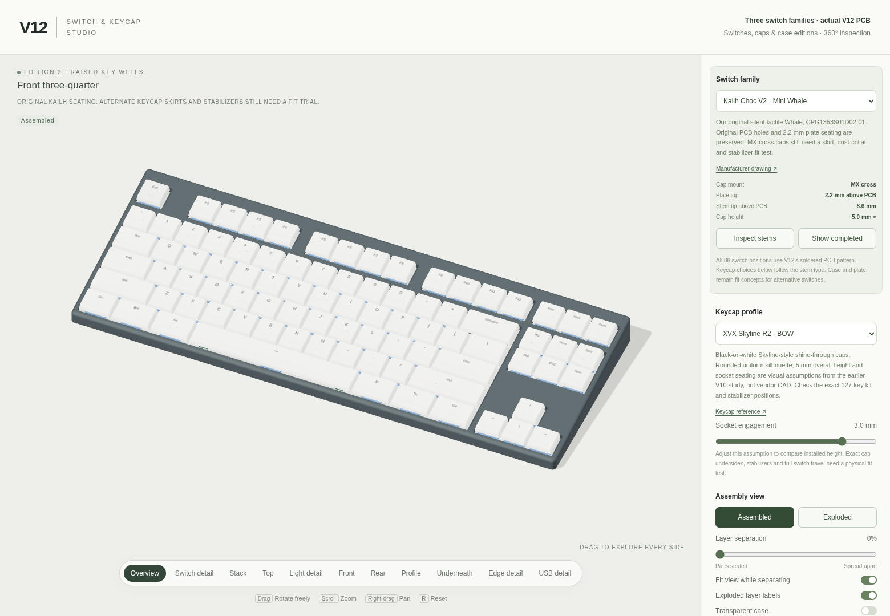

# TKL keyboard designs

Low-profile tenkeyless keyboard designs, from the original KiCad project to
later nRF52840 boards, case designs, and switch-plate lighting experiments.
The repository contains PCB and schematic sources, mechanical models,
manufacturing exports, firmware configuration notes, and interactive 3D viewers.

*V12 assembly visualization. Fit, lighting, and alternate switch-family support
still require physical prototype testing.*

## Start here

The latest revision is **[TKL v12](tkl/tkl12/README.md)**: an 86-key PCB with
soldered mounting patterns for Kailh Choc V1, Kailh Choc V2, and selected Gateron
Low Profile 3.0 switches. Its case and plate requirements depend on the chosen
switch family; see the [compatibility notes](tkl/tkl12/SWITCHES.md).

- **Explore the design:** clone or download the repository, then open
  `tkl/tkl12/render-switches/index.html` locally in Chrome or Brave. The
  [switch and keycap studio](tkl/tkl12/render-switches/README.md) works offline.
- **Open the CAD:** use [keyboard.kicad_pro](tkl/tkl12/kicad/keyboard.kicad_pro)
  in KiCad 10 to inspect the latest PCB and schematic.
- **Review fit models:** start with the
  [PCB models and switch-fit coupon](tkl/tkl12/case/README.md).
- **Review fabrication outputs:** read the
  [ordering notes](tkl/tkl12/manufacturing/ORDERING.md) and
  [fabrication instructions](tkl/tkl12/manufacturing/FABRICATION.md).
- **Check or regenerate exports:** follow the
  [revision's source and checking instructions](tkl/tkl12/scripts/README.md).

Recent revisions are prototypes with software validation records. Hardware
bring-up, switch and stabilizer travel, battery integration, and optical
performance still need physical testing. Read the chosen revision's notes and
[bring-up procedure](tkl/tkl12/BRINGUP.md) before ordering or assembling a board.

## Design revisions

Each major version has one commit. The original project is preserved as v0;
decimal variants stay with their major version. Earlier designs remain in
their own directories so their sources and design choices can be compared.

| Version | Design |
| --- | --- |
| [v0](tkl/tkl0/README.md) | Original KiCad project |
| [v1](tkl/tkl1/README.md) | Initial keyboard layout and KiCad design |
| [v2](tkl/tkl2/) | Early PCB and schematic revision |
| [v3](tkl/tkl3/) | Early PCB and schematic revision |
| [v4](tkl/tkl4/) | PCB and case design |
| [v5](tkl/tkl5/) | PCB and case refinement |
| [v6](tkl/tkl6/) | Controller-module board and case |
| [v7](tkl/tkl7/README.md) | Integrated nRF52840 design and v7.x alternatives |
| [v8](tkl/tkl8/README.md) | Top-mounted LED design |
| [v9](tkl/tkl9/README.md) | Direct rear USB module and v9.x case revisions |
| [v10](tkl/tkl10/README.md) | Esc/F1 controller position, case variants, and lighting studies |
| [v11](tkl/tkl11/README.md) | Reverse LEDs and acrylic switch plate |
| [v12](tkl/tkl12/README.md) | Multiple soldered low-profile switch families |

v7 alternatives: [v7.3](tkl/tkl7.3/README.md), [v7.4](tkl/tkl7.4/README.md),
and [v7.5](tkl/tkl7.5/README.md).

v9 case revisions: [v9.1](tkl/tkl9.1/README.md), [v9.2](tkl/tkl9.2/README.md),
and [v9.3](tkl/tkl9.3/README.md).

Shared [mechanical tools](tkl/mechanical/README.md), [research](tkl/research/),
and [handoff packaging](tkl/package_handoff.py) support the later designs.

## Finding the files

Recent revision directories use the following structure:

| Path | Contents |
| --- | --- |
| `kicad/` | PCB, schematic, project settings, and local component libraries |
| `case/` | Mechanical models, print-fit gauges, and fit documentation |
| `manufacturing/` | Gerbers and drills, BOM and placement files, assembly drawings, and ordering notes |
| `firmware/` | Controller, matrix, and lighting configuration references |
| `scripts/` | Design generation, export, and validation tools |
| `validation/` | Saved electrical, mechanical, and export check results |
| `reference/` | Manufacturer drawings, design studies, and preserved source records |
| `render-*/` | Browser viewers, assembly previews, and rendering sources |

The original v0 and v1 KiCad projects retain their `tkl.kicad_pro` filenames
directly inside `tkl/tkl0/` and `tkl/tkl1/`.

Use the PCB, manufacturing files, and mechanical parts from the same revision
unless its documentation explicitly identifies a compatible earlier part.
Print-fit gauges intentionally enlarge some holes; use the Gerber and drill
exports for PCB fabrication.

## Working with the sources

Recent electrical designs use KiCad 10. Python generators may need KiCad's
`pcbnew` module and additional geometry packages; mechanical tools use CadQuery,
and viewer generators have their own Python or Node dependencies. Follow the
instructions and dependency files beside the tool you want to run.

The final routed PCB is the source for normal checks and manufacturing exports.
Some revision-building scripts reset from an earlier baseline or change routing;
read their instructions before running them.

## Third-party credits

Rendering studies include third-party software and meshes. See the
[v12 viewer attributions](tkl/tkl12/render-switches/ATTRIBUTIONS.md) and the
attribution and license files included with each rendering study.
