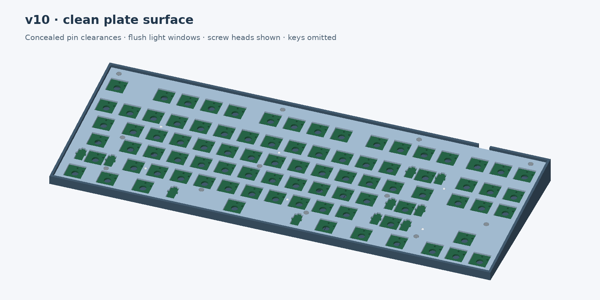

# TKL v10 — controller between Esc and F1

New electrical and mechanical revision, with the nice!nano v2-compatible
TENSTAR nRF52840 clone beneath the gap between **Esc and F1**. Its USB-C socket
faces the rear and connects directly through the recessed case bezel.
**SW15, SW9 and SW16 are restored** above Insert/Home/Page Up: 86 keys total.
All 86 switch centers and drill patterns match v7.5; the other revisions are
preserved in their own directories.

The separate, plain switch plate and continuous base rim carry forward the
v9.3 appearance. Controller/connector pin clearances stay hidden in underside
pockets. Six flush translucent inserts cover the light openings. There is no
top cover or raised separator between key rows.

- Same 355.56 × 133.352 mm case footprint and 7.3 mm front / 20.6 mm rear height.
- Twelve M2 × 5 button-head screws and DIN 934 M2 nuts. H9 and H12 move to clear
  the left controller and restored keys. **Use the v10 PCB, base and plate together.**
- Battery bay moves right. Designed around the advertised **147 × 44 × 5 mm
  5044147 pack**, with a 149 × 46 × 5.5 mm maximum complete-pack allowance and
  155 × 50 × 6.3 mm reserved volume. This replaces the old 270 mm-wide reserve.
  Actual wrapped dimensions, protection and charging compatibility need checking.
- Two copper layers, 1.6 mm FR-4, lead-free HASL and bottom-only assembly remain
  the cost target. Seven factory BOM groups / 102 placements, including the
  three restored diodes. The user installs the clone and key switches.

## Files

- [Complete print kit](case/tkl-v10-print-kit.zip)
- [Small fit coupons](case/tkl-v10-fit-coupons.zip): start with the **rear-left**
  module/USB corner and M2 mounting trial.
- [KiCad PCB](kicad/keyboard.kicad_pcb) and [schematic](kicad/keyboard.kicad_sch)
- [Prototype manufacturing handoff](manufacturing/tkl-v10-prototype-handoff.zip)
- [Factory settings and upload instructions](manufacturing/ORDERING.md)
- [Build and check commands](scripts/README.md)
- [Bench/assembly checks](BRINGUP.md)
- [Placement map](case/layout-preview.svg) and [mounting plan](case/mounting-plan.svg)

## Fit and validation limits

The model uses the supplied 33 × 18 mm clone PCB and 0.84 mm socket overhang.
Overall module thickness is still modeled at 5 mm and the USB axis at 3.5 mm
below the carrier, with a 1 mm mounting gap. The modeled module clears the
floor by 4.49 mm. Measure and test the actual clone before fabrication.

The antenna exclusion ends before SW25's switch pin, leaving less forward
clearance than v9. No carrier copper, pads or vias are permitted in that
exclusion, but nearby switch metal remains. **Check Bluetooth range in the
assembled plastic case.** Do not treat the CAD fit or electrical rule checks
as an RF test.

Install and test the controller before the plate and keys. Trim module pins,
solder, auxiliary wires and J1 tails to **at most 1 mm above the PCB**. Blind
pockets provide 0.3 mm clearance with a 0.9 mm roof. Tall sockets do not fit.
The three auxiliary pads still need a physical registration check.

ERC and DRC pass with zero errors or warnings; all 86 matrix addresses are
unique, all 407 numbered pads match the schematic, and there are no opens.

Machine-readable results are in `validation/summary.json`,
`validation/revision-audit.json`, `case/fit-report.json`,
`case/mesh-validation.json`, `case/surface-validation.json` and
`case/usb-opening-validation.json`. These establish CAD, file and electrical
rule consistency only; firmware, charging, physical fit and switch/stabilizer
travel remain prototype tests. No v10 live quote or order has been created.
