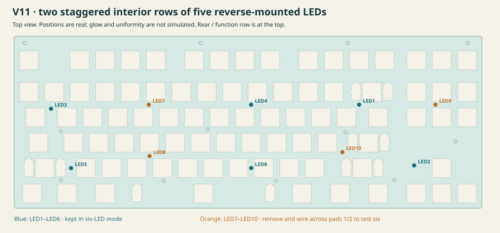

# TKL v11 — ten reverse LEDs, convertible to six

V11 preserves v10's 86-key layout, Esc/F1 controller position, direct rear USB,
board outline, two copper layers, 1.6 mm thickness and twelve M2 mounting holes.
V10 and the earlier lighting studies are unchanged.

Ten **LTW-C230DS reverse-mounted white LEDs** shine upward through ten PCB slots
into the underside of an **acrylic switch plate**. No side-emitting LEDs or
separate guide beneath the PCB are used in this revision. Acrylic diffusion,
legend brightness and uniformity are an experiment, not established performance.

The ten sources now occupy **two staggered interior rows of five**, following
the shared placement guidance.
Their optical entries lie beneath connected acrylic between the switch openings,
with five horizontal lighting zones per row. These are geometric prototype
placements, not a prediction of measured illumination uniformity.

LED1 stays below Backspace at the boundary between `]` and `\ |`, 28.25 mm left
of its original V10 position. LED6 also retains its preceding V11 position.
Eight other LEDs move to distribute the light across the interior. LED10 is
offset around an existing bottom-case support. Switches and non-LED components,
LED type/count and maximum current, and factory placement count are unchanged.
The series wiring follows the new arrangement; driver components stay in place.
The earlier V11 sources and handoff are saved in `reference/before-staggered-layout/`.

[Close-up of LED1's new position](case/led1-placement.svg)

## Ten now, six later

All ten LEDs form **one regulated series string**. To use six sources
(LED1–LED6, including the relocated LED1):

1. Disconnect the battery and USB. Allow at least 30 seconds for the output
   capacitor to discharge; verify `LED_HV` is below 5 V before soldering.
2. Remove **LED7, LED8, LED9 and LED10**.
3. At **each** removed LED, solder a short insulated wire between its existing
   pads **1 and 2**. The pad centers are 3.8 mm apart; route the wire on the
   component/bottom side and avoid other pads or protruding into the plate.
4. Check the four bridges and test at low brightness before closing the case.

The driver automatically supplies the lower voltage required by six LEDs.
The remaining LEDs keep approximately the same current at the same PWM setting.
Six sources give less total light than ten at that current, so compare actual
legends before choosing which sources to remove. Any four can be bypassed;
LED7–LED10 are the documented removals for six-source operation. This retains
three sources in each interior row, using the new V11 coordinates. Their
brightness and coverage still need comparison against the full ten-source build.

**Never bridge R10.** It is the 100 ohm current-sense resistor, not an LED jumper.
Keep at least six LEDs installed for this documented configuration range. The
string is interrupted if an LED is removed without installing its wire bridge.
Changing ten to six this way requires no firmware or resistor change.

## Circuit and assembly

- `U2`: TPS61169DCKR / C71045, SC70-5. Battery-fed constant-current boost driver.
- `R10`: 100 ohm. Nominal maximum current is 204 mV / 100 ohm = **2.04 mA**
  through every installed LED. Current decreases with PWM brightness.
- `BL_EN`: existing module P0.31, active-high **20 kHz PWM**; low shuts the driver
  down. This driver converts PWM into analog current dimming.
- `L1`: 10 uH FNR4018S100MT; its 1.1 × 3.7 mm lands, 1.9 mm gap match the
  selected KiCad footprint. Normal/startup pulse current still needs measuring.
- `D87`: SS16, 60 V rectifier. `C1/C2`: 4.7 uF, 50 V X7R, one shared SKU.
- `R11`: 1 Mohm output bleeder; shares the same SKU as PWM pull-down R9.
  Approximate bleeder dissipation is 0.9 mW at 30 V.
- `LED_HV` is approximately the sum of the installed LEDs' forward voltages
  plus 0.204 V; typically around 30–32 V for ten or 18–19 V for six. The battery
  remains one cell. Use 50 V output capacitors and the specified 60 V diode.

**All 106 factory placements are on the bottom side.** There are ten factory
BOM groups, versus seven groups / 102 placements in v10. Reusing the LED SKU,
one shared capacitor SKU, and the two 1 Mohm resistors limits additional
feeder types. The user fits the switches and clone module after delivery.
The target remains **Economic assembly, lead-free HASL and lead-free solder**.
The existing reverse-LED handling/fixture charge may still apply. No new JLC
quote or order has been made; exact stock and total cost must be checked live.

## Files

- [Interactive 360° assembly and exploded-view studio](render-assembly/index.html):
  both case editions, keycap profiles, acrylic treatments, layer visibility and
  adjustable separation. The separate acrylic plate/frame remain a fit concept.
- [KiCad PCB](kicad/keyboard.kicad_pcb) and [schematic](kicad/keyboard.kicad_sch)
- [Manufacturing prototype handoff](manufacturing/tkl-v11-prototype-handoff.zip)
- [Ordering settings](manufacturing/ORDERING.md)
- [Electrical/optical bench procedure](BRINGUP.md)
- [LED and acrylic trial layout](case/lighting-layout.svg)
- [LED coordinate table](case/lighting-placement.csv): X from the left, Y from the
  front edge, in millimeters; also includes native KiCad coordinates.
- [Acrylic plate trial DXF](case/acrylic-plate-trial.dxf)
- [Native bare PCB model](case/pcb-bare.stl): KiCad exports the 1.53 mm FR-4
  substrate without the outer copper of the nominal 1.6 mm finished board.
- [PCB print-fit gauge with enlarged holes](case/pcb-fit-check.stl): switch/module
  plated-pin holes +0.4 mm diameter; plastic and mounting holes +0.3 mm. These
  allowances affect this STL only; fabrication holes are unchanged. The fit
  gauge uses 1.6 mm finished thickness and is the model intended for printing.

The acrylic DXF is a **2D trial pattern**, not a replacement for the latest
integrated/hidden-mount case upper. It preserves switch and diagnostic stabilizer
openings and shows optional M2 locations on a reference layer. Do not cut holes
over the ten LED entry locations: keep clear acrylic there. The ETCH layer marks
small optional underside optical trial patches, not a validated light-guide pattern.
The sheet remains clear elsewhere: uniform frosting could extract light too early.
Efficient lateral injection still requires optical coupling trials, such as an
angled feature above the LED slot; relocation alone does not establish that.
Existing printed plates with only six opaque-covered light openings will not
demonstrate the intended ten-source acrylic effect. Acrylic brittleness, switch
retention, stabilizers and the complete mounting arrangement need a fit coupon.

## Validation limits

The checks compare every numbered pad against the schematic, preserve the entire
key matrix and mechanical interfaces, verify bottom-only factory placement, and
enumerate all **386 possible six-through-ten-LED population combinations** with
wire bypasses. The checked manufacturing sources remain a prototype: no physical
LED, driver, battery, charging, RF, acrylic or case-assembly test has been performed.
See `validation/summary.json` and `validation/revision-audit.json` for actual
software results. CAD/netlist checks are not a hardware certification.

Primary circuit reference: [TI TPS61169 datasheet](https://www.ti.com/lit/ds/symlink/tps61169.pdf).
JLC lists [TPS61169DCKR for Economic and Standard assembly](https://jlcpcb.com/partdetail/TexasInstruments-TPS61169DCKR/C71045).
