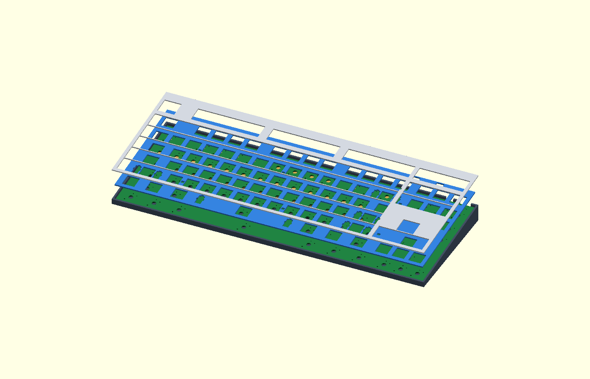

# TKL v8: separate plate, low-profile caps and fixed thin case

These fit models also apply to **v8.2**. The fabrication revision changes
via drills, switch-hole copper routing and the diode manufacturer. The diode's
1.25 mm maximum height fits the existing 1.35 mm envelope. An independent
geometry comparison confirms the same outline, component holes, positions and
component envelopes; no reprint is needed for this revision. Source metadata
is updated in the fit archive. See `../validation/fabrication-cost-audit.json`.

Use these files for a physical fit test. The **XVX Skyline R2, advertised 5 mm
low-profile caps** are the design target. Your KBDiy KOA set is advertised as
9 mm and is recorded as an alternate. Both purchased stabilizer sets are
plate mount. Their latch, body/wire clearance and travel with Choc V2 remain
unverified; the plate slots are diagnostic, not approved production geometry.

## Start with the small sample

Print the matched **`stabilizer-test/2u-pcb-for-1.5mm-plate.stl`** and
**`stabilizer-test/2u-plate-1.5mm.stl`**, then try an actual Choc V2 switch,
a pair of Durock or TX AP stabilizers and an XVX 2u cap. Test each stabilizer
set separately. Follow [the sample instructions](stabilizer-test/README.md)
and repeat with the 6.25u spacebar sample. These fit a 256 mm printer.

**Discard the old sample supports:** the corrected plate TOP is 2.2 mm above
the PCB. The prior sample incorrectly used that value for the underside.
The corrected 1.5 mm plate has only **0.7 mm clear space beneath it**. If the
stabilizer hits the PCB, the diagnostic relief sample can locate the problem;
neither routed PCB contains stabilizer relief cutouts yet. Do not solder all
86 switches or release the Gerbers before this is resolved.

## How the pieces fit

From the bottom upwards: a flat case floor supports the padded battery; case
bosses/perimeter ledges support the PCB; 0.7 mm prototype feet support the
1.5 mm plate on the PCB; the cover sits 0.4 mm above the plate. Its small feet
rest on the plate above PCB/case supports. The plate has 86 switch openings,
slots at all five stabilized keys, JST-tail clearances and six LED apertures.
There is no higher case ledge obstructing vertical insertion of the PCB.

| Plane or part | Height from PCB underside, perpendicular to PCB |
| --- | --- |
| PCB | 0–1.6 mm |
| Air space / plate feet | 1.6–2.3 mm |
| Separate plate | 2.3–3.8 mm (1.5 mm material) |
| Gap below cover | 3.8–4.2 mm |
| Cover | 4.2–5.4 mm (1.2 mm material) |
| Choc V2 unpressed stem top | 10.2 mm (8.6 mm above PCB top) |

The **assembled lip heights are 7.3 mm front / 20.6 mm rear**, with 5.70°
tilt. These include the cover and preserve the requested thin profile. Lip
height excludes switches and keycaps. The outside footprint is 355.56 × 133.35 mm.
The wide battery bay uses the deeper space near the rear; a clearance tunnel
under the rear PCB ledge allows the bay to approach the rear wall.

The floor is 1.2 mm beneath the battery. Small internal pockets beneath front
diodes D77–D86 leave about 0.836 mm of material and 0.4 mm modeled component
clearance; the exterior bottom is still flat. Test the thin floor and the long
rear PCB span for flex. CAD collision checks do not establish stiffness.

For a fit trial, place the battery gauge within the floor's low locating
corners; place the matched PCB/plate with switches into the open case; lower
the cover over the switches; then install the keycaps. Check full travel at
every wide key and access to rear USB and power switch. The assembled plate
rests on the PCB and is located by the switches. The case, PCB and cover are
still gravity seated; transport fastening is not finalized.

## Printable and CAD files

| File | Purpose |
| --- | --- |
| `case.stl` | Wedge case with flat floor, PCB supports and battery locating corners |
| `cover.stl` | Flat-oriented drop-on cover, outside flush with case |
| `plate-supported.stl` | Full diagnostic plate, with integral 0.7 mm feet underneath |
| `plate-supported-left/right.stl` | Plate split to fit a 256 mm printer |
| `plate-flat-1.5mm.stl`, `plate-diagnostic.dxf` | Flat plate without feet; review geometry only, needs separate 0.7 mm spacers |
| `plate-supported.step` | Plate in PCB-local assembly coordinates |
| `pcb-left/right.stl` | 1.6 mm PCB gauge with actual switch/connector holes; insert real switches |
| `pcb-populated-left/right.stl` | PCB with conservative electronics and solder-pin envelopes |
| `pcb-bare.stl`, `pcb-populated.stl` | Full PCB gauges for a large printer |
| `pcb-populated.step` | PCB and fitted component envelopes |
| `fit-assembly.step` | Case, plate, PCB, cover, battery reserve, switches and cap envelopes |
| `fit.scad`, `fit-preview.png` | Exploded view of printable parts |
| `stack.svg` | Annotated stack diagram; dimensions control, not drawing scale |
| `case-left/right.stl`, `cover-left/right.stl` | Optional split shell/cover trials, tape or glue at butt seams |
| `battery-pack-max-gauge-264x50x5.5.stl` | Finished-pack target: 264 × 50 × 5.5 mm, including wrapping and protection board |
| `battery-reserve-gauge-270x52x6.3.stl` | Reserved space: 270 × 52 × 6.3 mm, including provisional growth/assembly room |
| Battery gauge `-left/right.stl` files | Butt-join the two halves when using a 256 mm printer |
| `battery-space.svg` | Plan view of the bay and fixed case dimensions |
| `keycap-envelopes-left/right.stl` | Separate 5 mm cap boxes; no real underside/socket detail |

Import STLs at **100% in millimetres**, without automatic scaling. PCB and
plate splits follow the same stairstep seam; align their upper faces, not the
lowest component/foot surfaces. The seam stays clear of switch drills; tape
or brace it for a fit trial. Each left/right part fits a 256 × 256 mm bed.
The full one-piece case and plate give a better stiffness test.

Use 0.1 mm layers for the 1.5 mm plate and 0.7 mm feet, and measure the result.
Supported plate and cover prints need support beneath their wide undersides,
or print them upside down with the feet pointing up. Populated PCB mocks also
need supports. Bare PCB gauges are easier when using real switches. Nominal
printed drill holes may need reaming; never scale the PCB to enlarge holes.
FDM plate flex/latches do not establish a final material or production tolerance.

## What is and is not verified

`fit-report.json` checks modeled case/PCB/plate/cover/component/switch/battery
intersections. `mesh-validation.json` checks all STL meshes and split bed sizes.
Actual stabilizer solids, cap underside and full key travel are **not checked**.
The cap envelope is 5 mm tall, with an assumed 18 × 17 mm 1u footprint, 3 mm
socket insertion and 0.6 mm cover clearance per side. These are not measured
XVX dimensions and must not be read as an installed-height guarantee.

The battery reserve is **270 × 52 × 6.3 mm**, for a finished pack up to
**264 × 50 × 5.5 mm**. It includes 0.8 mm extra thickness plus a separate
0.5 mm padding allowance below. A retail pack has not been selected; expansion
allowance is provisional and the size gauge has no assigned capacity.
[BATTERY.md](BATTERY.md) covers sourcing references,
connector, external NTC and unresolved charging-temperature compatibility.
Real wiring, coax bends, adhesive and pack expansion still need a physical
check. Component blocks are conservative envelopes, not manufacturer CAD.

Source geometry comes from this revision's routed PCB, without XY scaling.
See [the shared generator guide](../../mechanical/README.md),
[the purchased hardware record](OWNED_PARTS.md) and `fit-config.json`.
The inherited `keyboard-plate.*` / `tklplate.stl` outside this folder remain
obsolete; the new `plate-*` files here are the current diagnostic prototype.

